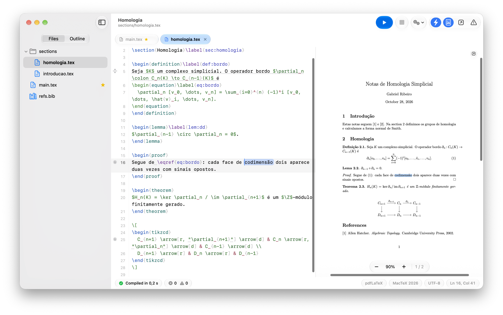

<p align="center">
  
</p>

<h1 align="center">GabeTeX</h1>

<p align="center">
  <b>Um editor LaTeX feito para projetos, não só para arquivos.</b><br>
  Compilação ao vivo enquanto você digita, PDF integrado com sincronização precisa nos dois sentidos e uma interface que parece nativa em cada plataforma.
</p>

<p align="center">
  <a href="https://github.com/gabe-rbo/GabeTeX-macOS/releases/latest"></a>
  <a href="LICENSE"></a>
  <a href="https://github.com/gabe-rbo/GabeTeX-macOS/actions/workflows/ci.yml"></a>
</p>

<p align="center">
  <a href="https://github.com/gabe-rbo/GabeTeX-macOS/releases/latest/download/GabeTeX.dmg"></a>
</p>

<p align="center">
  <a href="https://gabe-rbo.github.io/GabeTeX/">Site</a> ·
  <a href="https://github.com/gabe-rbo/GabeTeX-macOS/releases">Versões do macOS</a> ·
  <a href="CHANGELOG.md">Histórico de mudanças</a> ·
  <a href="CONTRIBUTING.md">Como contribuir</a> ·
  <a href="README.md">English</a>
</p>

<p align="center">
  
</p>

---

> Este é o **repositório guarda-chuva** do GabeTeX. Ele reúne o site, os arquivos da comunidade e um submódulo Git por
> plataforma. Os apps em si, com instruções de compilação, versões e issues, ficam nos repositórios de cada plataforma abaixo.

## Plataformas

| Plataforma | Situação | Tecnologia | Repositório | Download |
|---|---|---|---|---|
| **macOS** | Disponível | Swift, SwiftUI e AppKit (macOS 26+, Apple Silicon) | [GabeTeX-macOS](https://github.com/gabe-rbo/GabeTeX-macOS) | [Versões](https://github.com/gabe-rbo/GabeTeX-macOS/releases) · [GabeTeX.dmg](https://github.com/gabe-rbo/GabeTeX-macOS/releases/latest/download/GabeTeX.dmg) |
| **Linux** | Em desenvolvimento | Tauri 2 | [GabeTeX-Linux](https://github.com/gabe-rbo/GabeTeX-Linux) | Ainda não lançado |
| **Windows** | Em desenvolvimento | Tauri 2 | [GabeTeX-Windows](https://github.com/gabe-rbo/GabeTeX-Windows) | Ainda não lançado |

## Por que o GabeTeX

O GabeTeX foi escrito por um matemático que guarda cada artigo como um `main.tex` mais um arquivo por seção e queria
um editor que trate isso como o caso normal. Ele tem três objetivos:

1. **Nativo e bonito.** No macOS: SwiftUI e AppKit, o visual Liquid Glass do macOS 26, modo claro e escuro, sem web
   view, sem Electron, sem dependências de terceiros.
2. **Projetos, não arquivos.** Abra uma pasta e tenha árvore de arquivos, abas, *Quick Open*, uma estrutura do
   documento que atravessa todos os arquivos incluídos e navegação com ⌘-clique em `\input`, `\include` e `\ref`.
3. **Se adapta ao seu TeX.** O GabeTeX encontra a distribuição TeX que você já tem, compila em segundo plano enquanto
   você digita, mostra os erros na linha certa do arquivo certo e oferece instalar os pacotes que faltam.

## Principais recursos

*Descritos para o app de macOS, que já está disponível. Os apps de Linux e Windows estão sendo construídos com os mesmos objetivos.*

- **Projetos e navegação:** abra qualquer pasta ou comece por um template (Artigo, Tese, Beamer, Notas de Matemática,
  Lista de Exercícios); árvore de arquivos, abas, Quick Open (⌘P) e estrutura entre arquivos; escrita com um arquivo
  por seção usando os comentários mágicos `% !TEX root` e `% !TEX program`.
- **Compilação ao vivo:** detecta MacTeX, TeX Live, BasicTeX e TinyTeX, executa o `latexmk` (pdfLaTeX, XeLaTeX,
  LuaLaTeX) em segundo plano numa cópia privada, então seus arquivos não são tocados até você salvar; o texto não
  salvo entra na compilação.
- **Erros no lugar certo:** diagnósticos do log do TeX e do ChkTeX sublinhados na linha certa do arquivo certo, painel
  de Problemas, avisos ao vivo de rótulos ausentes, rótulos duplicados e citações ausentes, e instalação de pacotes
  que faltam com um clique via `tlmgr`.
- **PDF com sincronização nos dois sentidos:** visualizador integrado com SyncTeX, saltos precisos do código para o
  PDF e do PDF para o código que caem na palavra exata, e janela de PDF destacável.
- **Apresentações Beamer:** visão da plateia no monitor externo e visão do apresentador com próximo slide, cronômetro e notas.
- **Ferramentas de escrita:** autocompletar de comandos, ambientes, referências, citações e pacotes; contagem de
  palavras e páginas; Paleta de Comandos; atalhos editáveis; modo Vim opcional.
- **Rótulos de projeto, suporte à Touch Bar e interface bilíngue** (português do Brasil e inglês).

<p align="center">
  
</p>

<p align="center">
  
</p>

## Obtenha o GabeTeX

- **macOS:** baixe o [GabeTeX.dmg](https://github.com/gabe-rbo/GabeTeX-macOS/releases/latest/download/GabeTeX.dmg),
  arraste o app para Aplicativos e instale uma distribuição TeX, como o [MacTeX](https://tug.org/mactex/).
  Instruções de instalação, o passo "Abrir Mesmo Assim" do primeiro uso, atalhos e como compilar estão no
  [README do GabeTeX-macOS](https://github.com/gabe-rbo/GabeTeX-macOS#readme).
- **Linux e Windows:** ainda não lançados. Acompanhe o [GabeTeX-Linux](https://github.com/gabe-rbo/GabeTeX-Linux) e o
  [GabeTeX-Windows](https://github.com/gabe-rbo/GabeTeX-Windows).

O [site](https://gabe-rbo.github.io/GabeTeX/) lista todas as versões do macOS, com as notas de cada uma.

## Estrutura do repositório

```text
GabeTeX/
├── GabeTeX-macOS/     submódulo → github.com/gabe-rbo/GabeTeX-macOS   (app Swift, versões, CI)
├── GabeTeX-Linux/     submódulo → github.com/gabe-rbo/GabeTeX-Linux   (Tauri 2, em desenvolvimento)
├── GabeTeX-Windows/   submódulo → github.com/gabe-rbo/GabeTeX-Windows (Tauri 2, em desenvolvimento)
├── docs/              o site do GabeTeX (GitHub Pages)
├── .github/           modelos de issue e de pull request, workflow do Pages
├── CHANGELOG.md  CONTRIBUTING.md  CODE_OF_CONDUCT.md  SECURITY.md  LICENSE
└── README.md  README.pt-BR.md
```

Cada plataforma é um repositório independente, com histórico, issues e versões próprios. Este repositório fixa um
commit específico de cada um.

Clone tudo de uma vez:

```sh
git clone --recurse-submodules https://github.com/gabe-rbo/GabeTeX.git
```

Se você já clonou sem os submódulos:

```sh
git submodule update --init
```

Para atualizar os submódulos fixados para o commit mais recente da branch padrão de cada um:

```sh
git submodule update --remote
```

## Como contribuir

Relatos de bugs, ideias e pull requests são bem-vindos, **em português ou em inglês**. Comece pelo
[CONTRIBUTING.md](CONTRIBUTING.md) (em inglês), que explica como escolher o repositório certo, e depois siga o guia
da plataforma. Bugs específicos de uma plataforma devem ir para as issues do repositório dela.

## Licença

O GabeTeX é distribuído sob a [Licença MIT](LICENSE). Copyright © 2026 Gabriel Ribeiro.
